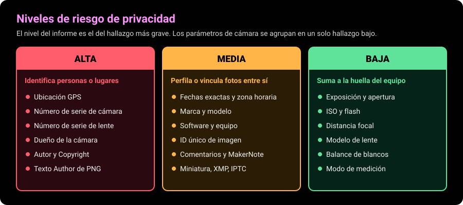
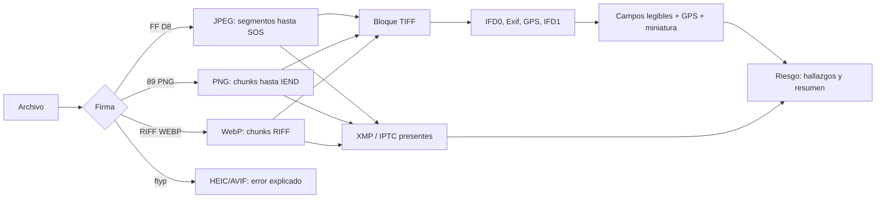
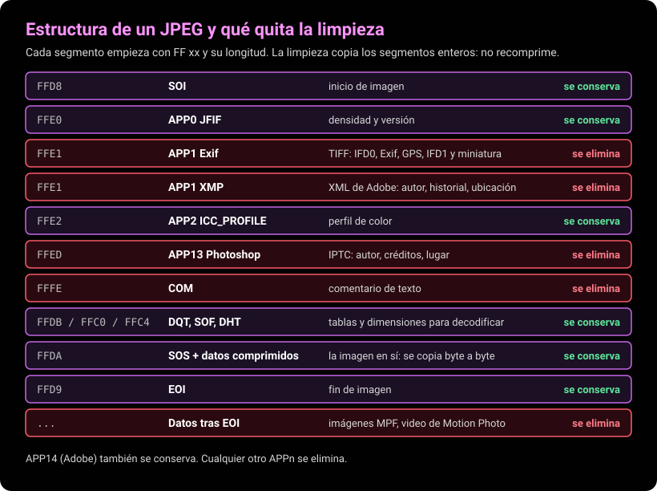
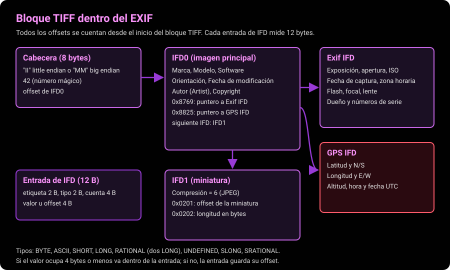

# Analizador EXIF

Lee los metadatos EXIF de fotos JPEG, PNG y WebP, evalúa qué revelan sobre quien las tomó y genera copias limpias **sin recomprimir** la imagen. Funciona como librería TypeScript sin dependencias, como CLI en Node y como página local en el navegador. Nada sale de tu equipo: no hay red, almacenamiento ni analítica.

Demo en vivo (versión ligera, solo JPEG): https://mino-mateo.github.io/#demo-exif

> [!IMPORTANT]
> Úsalo con fotos propias o con material que tengas derecho a analizar. Ver [Uso ético](#uso-ético).

## Qué hace y qué no hace

Hace:

- Lee EXIF en **JPEG** (segmento APP1), **PNG** (chunk `eXIf`) y **WebP** (chunk `EXIF` dentro de RIFF/VP8X).
- Entiende TIFF en **little endian** (`II`) y **big endian** (`MM`), con IFD0, Exif IFD, GPS IFD e IFD1 (miniatura incrustada, si existe).
- Decodifica los tipos BYTE, ASCII, SHORT, LONG, RATIONAL, UNDEFINED, SLONG y SRATIONAL (además de SBYTE, SSHORT, FLOAT y DOUBLE).
- Traduce unas 80 etiquetas a nombres en español y valores legibles: `1/125 s`, `f/2.8`, `ISO 200`, `4.2 mm`, flash decodificado, orientación descrita, fechas `2026-09-29 10:15:00`, GPS en grados, minutos y segundos con su valor decimal y signo.
- Muestra también las etiquetas desconocidas (`Etiqueta 0xfde8`), porque en una investigación importa ver todo lo que hay.
- Detecta la presencia de **XMP** (JPEG, PNG y WebP) e **IPTC** (APP13 de Photoshop en JPEG).
- Lee los textos de PNG (`tEXt`, `iTXt`) y la fecha `tIME`.
- Evalúa el **riesgo de privacidad**: lista de hallazgos con severidad alta, media o baja, y un resumen.
- **Limpia** los metadatos copiando los bloques enteros que se conservan: los datos de imagen quedan idénticos byte a byte.
- Exporta los puntos GPS de varias fotos como **GeoJSON** para abrirlos en geojson.io o QGIS.
- Extrae la **miniatura** incrustada, que a veces muestra la foto antes de un recorte.

No hace:

- No lee HEIC, AVIF, TIFF/RAW ni video (ver [Limitaciones](#formatos-soportados-y-limitaciones)).
- No interpreta el contenido de XMP ni de IPTC: solo avisa de que están. Tampoco decodifica las MakerNotes propietarias de cada fabricante.
- No corrige la orientación al limpiar: si la foto dependía de la etiqueta Orientation, avisa.
- No verifica que una foto sea auténtica. Los metadatos se pueden editar o inventar con cualquier herramienta; son un indicio, no una prueba.

## Por qué importa

### En OSINT

Los metadatos son una de las primeras capas que se revisan al investigar una imagen:

| Pregunta | Qué campos ayudan |
|---|---|
| ¿Dónde se tomó? | Latitud, longitud, altitud y dirección de la cámara (GPS IFD) |
| ¿Cuándo? | Fecha de captura, zona horaria, hora GPS en UTC |
| ¿Con qué equipo? | Marca, modelo, lente, software |
| ¿Quién la tomó? | Autor, Copyright, dueño de la cámara, textos de PNG, XMP e IPTC |
| ¿Estas fotos vienen del mismo equipo? | Número de serie de cámara y lente, ID único de imagen, MakerNote |
| ¿Fue editada o recortada? | Software, fecha de modificación distinta a la de captura, miniatura que no coincide |

Casos de uso típicos: verificar el origen de una imagen que circula en redes (¿la fecha y el lugar cuadran con lo que se afirma?), geolocalizar una foto, detectar autoría o vincular varias publicaciones anónimas al mismo dispositivo. El modo `--geojson` sirve para ver de un vistazo dónde se tomaron todas las fotos de un conjunto.

### En privacidad

Una foto tomada con el celular puede llevar, sin que lo sepas, las coordenadas de tu casa, la hora exacta, el modelo de tu teléfono y hasta el número de serie de la cámara.

> [!NOTE]
> La mayoría de redes sociales (Instagram, Facebook, X, WhatsApp al enviar como foto) recomprimen la imagen y borran el EXIF. Pero **no todos los canales lo hacen**: enviar la foto "como archivo" o "como documento" en mensajería, adjuntarla a un correo, subirla a una web propia, a un foro, a un repositorio o a un almacenamiento en la nube suele conservar el archivo original con todos sus metadatos.

> [!WARNING]
> Limpiar el EXIF no anonimiza el contenido. Lo que se ve en la foto (fachadas, placas, reflejos, carteles, el cielo) también sirve para geolocalizar.



## Formatos soportados y limitaciones

| Formato | Lectura | Limpieza | Dónde está el EXIF |
|---|---|---|---|
| JPEG | sí | sí | Segmento APP1 que empieza con `Exif\0\0` |
| PNG | sí | sí | Chunk `eXIf` (PNG 1.5, 2017) |
| WebP | sí | sí | Chunk `EXIF` en contenedor RIFF con cabecera `VP8X` |
| HEIC / AVIF | no | no | Ítem `Exif` dentro de un contenedor ISO BMFF |
| GIF, BMP | no | no | No tienen EXIF estándar |

> [!WARNING]
> **HEIC no está soportado.** HEIC (el formato por defecto del iPhone) no es una secuencia de segmentos como JPEG: es un contenedor ISO BMFF, como MP4. El EXIF es un "ítem" cuyo lugar hay que resolver recorriendo las cajas `meta`, `iinf` e `iloc`, y la imagen está en HEVC, que los navegadores en su mayoría no decodifican. Limpiarlo sin recomprimir exige reescribir los offsets de `iloc`. Es un analizador aparte. Mientras tanto, la herramienta lo detecta y lo dice (`contenedor ISO BMFF (HEIC, AVIF o MP4)`). Alternativas: `exiftool foto.heic` para leerlo, convertir a JPEG antes de publicar, o en el iPhone usar Ajustes > Cámara > Formatos > "Más compatible" para que la cámara guarde JPEG.

Otras limitaciones conocidas:

- En JPEG solo se lee el primer APP1 Exif (el de la imagen principal). Las imágenes secundarias MPF o los videos de Motion Photo que van después del fin de imagen no se analizan, pero **sí se eliminan** al limpiar.
- En PNG, los `zTXt` y los `iTXt` comprimidos se muestran como "(texto comprimido, N bytes)": descomprimirlos exigiría zlib, y la librería no tiene dependencias. Se eliminan igual al limpiar.
- Las etiquetas de texto se decodifican como UTF-8 (muchos equipos escriben UTF-8 aunque la norma diga ASCII).
- Los offsets fuera del bloque TIFF se ignoran y los ciclos entre IFD se cortan: un EXIF corrupto no cuelga el programa, pero puede mostrar menos campos.

## Cómo funciona



### JPEG

Un JPEG es una secuencia de segmentos `FF xx` con su longitud, hasta `SOS` (inicio de los datos comprimidos). El EXIF va en un APP1. La limpieza copia los segmentos que se conservan tal cual y luego los datos desde `SOS` hasta `EOI` sin tocarlos, así que la imagen no se recomprime ni pierde calidad.



Para encontrar el `EOI` real se recorren los escaneos: dentro de los datos comprimidos un `FF` solo aparece como `FF 00` (relleno) o `FF D0` a `FF D7` (reinicio), así que el primer marcador distinto marca el fin del escaneo.

### TIFF (el contenido del EXIF)

El EXIF es un pequeño archivo TIFF: una cabecera que dice el orden de bytes y una cadena de directorios (IFD) con entradas de 12 bytes.



### PNG

```
89 50 4E 47 0D 0A 1A 0A          firma
+--------+------+-------+-----+
| largo  | tipo | datos | CRC |  cada chunk
+--------+------+-------+-----+
IHDR  tIME  iCCP  pHYs  eXIf  tEXt  iTXt  IDAT ... IEND
      ----              ----  ----  ----
      se eliminan: eXIf, tEXt, iTXt, zTXt, tIME
```

El CRC de cada chunk cubre solo su tipo y sus datos, así que copiar chunks enteros mantiene todos los CRC válidos. Se conservan `IHDR`, `PLTE`, `IDAT`, `iCCP`, `sRGB`, `gAMA`, `pHYs` y el resto.

### WebP

```
RIFF <tamaño> WEBP
  VP8X  flags: ICC 0x20 | alfa 0x10 | EXIF 0x08 | XMP 0x04 | animación 0x02
  ICCP  perfil de color
  VP8L  (o VP8) imagen comprimida
  EXIF  bloque TIFF                <- se elimina
  XMP   XML                        <- se elimina
```

Al limpiar se quitan los chunks `EXIF` y `XMP `, se apagan los bits 0x08 y 0x04 de `VP8X` y se recalcula el tamaño del contenedor RIFF. Los chunks tienen tamaño par (relleno de un byte si hace falta).

## Etiquetas y su riesgo

El nivel de riesgo de una foto es el de su hallazgo más grave.

| Etiqueta | Tag | Formato de ejemplo | Riesgo |
|---|---|---|---|
| Ubicación GPS (latitud, longitud) | GPS 0x02, 0x04 | `48° 51' 30.24" N (48.8584)` | alta |
| Altitud, hora y fecha GPS | GPS 0x06, 0x07, 0x1d | `35.5 m sobre el nivel del mar`, `08:15:00 UTC` | alta (con la ubicación) |
| Autor (Artist) | 0x013b | `Autor de ejemplo` | alta |
| Copyright | 0x8298 | `Demo (c) 2026` | alta |
| Dueño de la cámara (CameraOwnerName) | 0xa430 | `Propietario de ejemplo` | alta |
| Número de serie de la cámara (BodySerialNumber) | 0xa431 | `DEMO-000123` | alta |
| Número de serie de la lente (LensSerialNumber) | 0xa435 | `LENTE-000456` | alta |
| Texto PNG Author, Copyright | tEXt / iTXt | `Autor de ejemplo` | alta |
| Fecha de captura, digitalización y modificación | 0x9003, 0x9004, 0x0132 | `2026-09-29 10:15:00` | media |
| Zona horaria | 0x9010 a 0x9012 | `+02:00` | media |
| Marca y modelo | 0x010f, 0x0110 | `Demo`, `Camara de ejemplo` | media |
| Software y equipo | 0x0131, 0x013c | `Demo EXIF 1.0` | media |
| ID único de imagen (ImageUniqueID) | 0xa420 | `0123...cdef` | media |
| Descripción y comentario | 0x010e, 0x9286 | texto libre | media |
| MakerNote | 0x927c | `(1234 bytes)` | media |
| Miniatura incrustada | IFD1 0x0201 | `JPEG de 643 bytes` | media |
| Fecha tIME y otros textos de PNG | tIME, tEXt | `2026-09-29 10:15:00 UTC` | media |
| XMP, IPTC | APP1, APP13, iTXt, chunk XMP | `presente` | media |
| Exposición | 0x829a | `1/125 s` | baja |
| Apertura | 0x829d | `f/2.8` | baja |
| ISO | 0x8827 | `ISO 200` | baja |
| Distancia focal y equivalente 35 mm | 0x920a, 0xa405 | `4.2 mm`, `26 mm` | baja |
| Flash | 0x9209 | `Disparado, modo automático` | baja |
| Compensación de exposición | 0x9204 | `-0.7 EV` | baja |
| Lente y especificación | 0xa434, 0xa432 | `24-70 mm f/2.8-4` | baja |
| Programa, medición, balance de blancos | 0x8822, 0x9207, 0xa403 | `Normal`, `Matricial`, `Automático` | baja |
| Orientación | 0x0112 | `Rotar 90° en sentido horario` | sin riesgo (se avisa al limpiar) |

La lista completa de nombres está en `ETIQUETAS` y `ETIQUETAS_GPS` de [src/exif.ts](src/exif.ts).

## API

```ts
import { analizar, limpiar, evaluarRiesgo, detectarFormato, enlaceMapa, leerTiff } from "./src/exif.ts";

const a = analizar(bytes); // Uint8Array o ArrayBuffer (un Buffer de Node también sirve)
// a.formato      -> "jpeg" | "png" | "webp"
// a.orden        -> "little endian" | "big endian" | null (sin EXIF)
// a.campos       -> [{ grupo: "IFD0", tag: 0x010f, nombre: "Marca", valor: "Demo" }, ...]
// a.gps          -> { lat: 48.8584, lon: 2.2945, altitud: 35.5, fechaHora: "2026-09-29 08:15:00 UTC" } | null
// a.orientacion  -> 6 | null
// a.miniatura    -> Uint8Array (JPEG) | null
// a.xmp, a.iptc  -> boolean
// a.riesgo       -> { nivel: "alta", resumen: "Riesgo alto: 19 hallazgos (6 alta, 12 media, 1 baja). ...",
//                     hallazgos: [{ severidad: "alta", campo: "Ubicación GPS", valor: "48.8584, 2.2945", motivo: "..." }, ...] }

const l = limpiar(bytes);
// l.datos   -> Uint8Array con la copia limpia
// l.quitado -> ["APP1 Exif", "APP1 XMP", "APP13 IPTC/Photoshop", "COM (comentario)", ...]
// l.avisos  -> ['La foto tenía orientación "Rotar 90° en sentido horario" guardada en EXIF. ...']

enlaceMapa(a.gps!); // -> "https://www.openstreetmap.org/?mlat=48.8584&mlon=2.2945#map=17/48.8584/2.2945"
detectarFormato(bytes); // -> "jpeg" | "png" | "webp" | null
```

`analizar` y `limpiar` lanzan un `Error` con mensaje en español ante un formato no soportado o un archivo truncado. Sin dependencias en tiempo de ejecución; TypeScript solo para compilar. El mismo `dist/exif.js` corre en Node y en el navegador.

## CLI

Requiere Node.js 22.18 o superior (ejecuta TypeScript de forma nativa, sin compilar).

```bash
node bin/exif.ts foto1.jpg foto2.png foto3.webp       # tabla por archivo con riesgos
node bin/exif.ts --json fotos/*.jpg > informe.json    # salida JSON
node bin/exif.ts --geojson fotos/* > puntos.geojson   # FeatureCollection para geojson.io o QGIS
node bin/exif.ts --limpiar limpias/ fotos/*           # escribe copias limpias en limpias/
```

Ejemplo de salida:

```
test/fixtures/jpeg-be.jpg  [JPEG, TIFF big endian]
  -- IFD0
  Marca             Demo
  Modelo            Telefono de ejemplo
  Software          Demo OS 1.0
  -- Exif
  Exposición        1/60 s
  Apertura          f/1.8
  ISO               ISO 50
  Fecha de captura  2026-09-28 17:40:05
  Flash             No disparado, modo apagado
  Distancia focal   2.6 mm
  -- GPS
  Versión GPS       2.3.0.0
  Latitud           22° 57' 6.84" S (-22.9519)
  Longitud          43° 12' 37.8" W (-43.2105)
  Altitud           700 m sobre el nivel del mar
  XMP: no   IPTC: no
  Mapa: https://www.openstreetmap.org/?mlat=-22.9519&mlon=-43.2105#map=17/-22.9519/-43.2105

  Riesgo alto: 6 hallazgos (1 alta, 4 media, 1 baja). La foto revela dónde se tomó.
  [ALTA] Ubicación GPS: -22.9519, -43.2105
         Coordenadas exactas de donde se tomó la foto: pueden revelar domicilio, trabajo o rutina.
  [MEDIA] Marca: Demo
  ...
```

- Cada Feature del GeoJSON lleva `[lon, lat, altitud]` y las propiedades `archivo`, `fechaCaptura`, `fechaHoraGps`, `altitud`, `marca` y `modelo`.
- Si un archivo no se puede leer, el error va a stderr, se sigue con los demás y el código de salida es 1. Sin archivos, muestra la ayuda y sale con 2.
- `--limpiar` nunca sobrescribe el original: si la carpeta de salida es la misma, falla con error.

> [!WARNING]
> Al limpiar se pierde la etiqueta de orientación. Si la foto estaba "de lado" y el visor la giraba gracias al EXIF, la copia limpia se verá girada. La herramienta lo avisa; corrígela con un editor (rotación sin pérdida, por ejemplo `jpegtran -rotate 90`) antes de publicar.

## Página local

`index.html` es una página mínima: arrastra o elige varias fotos y verás la tabla de campos, los riesgos, la miniatura incrustada, un enlace a OpenStreetMap por cada foto con GPS y un botón para descargar la copia limpia. Tiene una Content Security Policy que bloquea cualquier conexión: las fotos no salen del navegador (el enlace al mapa solo se abre si haces clic).

```bash
npm install
npm run demo      # compila y sirve en http://localhost:8000
```

## Tests

```bash
npm install
npx tsc --noEmit  # tipos
npm test          # 26 tests con node:test
npm run build     # compila src/ a dist/
```

Los tests usan archivos sintéticos en `test/fixtures/`, generados por [test/fixtures/generar.py](test/fixtures/generar.py) con Pillow. Pillow no escribe sub-IFD (Exif, GPS, IFD1), así que el script arma el bloque TIFF a mano. Ninguno es una foto real: la marca es "Demo", los nombres son de ejemplo y el GPS apunta a lugares públicos famosos.

| Archivo | Qué prueba | GPS |
|---|---|---|
| `jpeg-le.jpg` | TIFF little endian con más de 40 etiquetas, SLONG y SRATIONAL, miniatura en IFD1, XMP, IPTC, COM, perfil ICC y una segunda imagen tras EOI | Torre Eiffel (N, E) |
| `jpeg-be.jpg` | TIFF big endian sin miniatura | Cristo Redentor (S, W) |
| `png-exif.png` | `eXIf`, `tEXt`, `iTXt` con XMP, `tIME`, `iCCP`, `pHYs` | Badwater Basin, bajo el nivel del mar (N, W) |
| `webp-exif.webp` | Chunks `EXIF`, `XMP ` e `ICCP` con `VP8X` | Ópera de Sídney (S, E) |
| `sin-exif.jpg` | JPEG sin metadatos | - |
| `no-soportado.gif` | Formato rechazado | - |

Qué se verifica: nombres y formato de cada campo, signo del GPS en los cuatro cuadrantes, detección de XMP e IPTC, niveles de riesgo, robustez ante offsets fuera de rango y ciclos de IFD, y la limpieza de los tres formatos (sin metadatos, datos de imagen idénticos, CRC de PNG válidos, flags de VP8X y tamaño RIFF correctos). Si Pillow está instalado, además se comprueba que Pillow abre cada copia limpia y que los píxeles decodificados son idénticos a los del original. También se prueba la CLI con `--json`, `--geojson`, `--limpiar` y el código de salida ante errores.

Para regenerar los archivos: `python3 test/fixtures/generar.py` desde la raíz del repo (requiere Pillow con soporte WebP).

## Uso ético

- Analiza fotos propias, material público en el marco de una investigación legítima o archivos que te hayan entregado con permiso.
- No uses los metadatos para localizar, acosar ni exponer a personas. Una coordenada GPS puede ser el domicilio de alguien.
- Si encuentras datos sensibles de terceros en una foto publicada (por ejemplo, en la web de una institución), la vía correcta es avisar al responsable para que la retire o la limpie, no difundirlos.
- Recuerda que el EXIF se puede falsificar: contrástalo con otras fuentes antes de sacar conclusiones.

## Estructura

```
src/exif.ts                 lectura (JPEG, PNG, WebP, TIFF), riesgo y limpieza
bin/exif.ts                 CLI: tabla, --json, --geojson, --limpiar
test/exif.test.ts           tests con node:test
test/fixtures/generar.py    generador de los archivos sintéticos
test/fixtures/*             archivos de prueba (sin datos reales)
docs/*.svg                  diagramas del README
index.html                  página local que usa dist/exif.js
```

## Autor

Mateo Miño, Investigador OSINT y Tech Lead en [eCondor Digital](https://econdordigital.org/). Portafolio: https://mino-mateo.github.io
